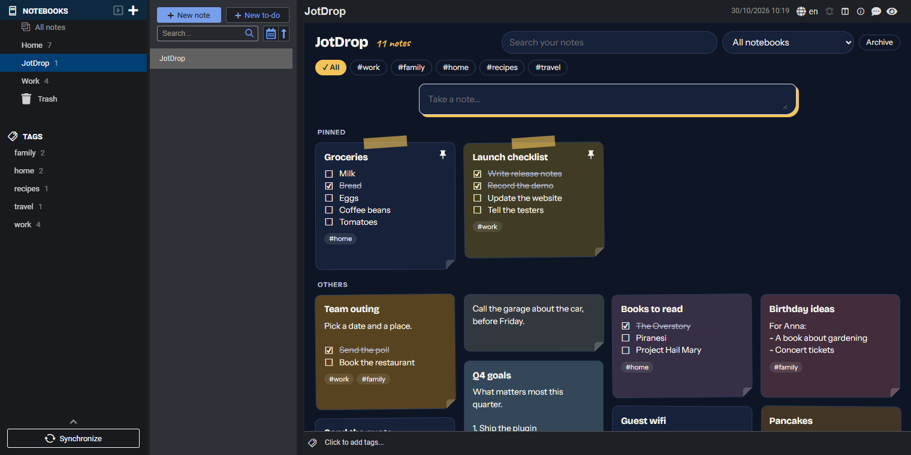

# JotDrop for Joplin

**All your notes as Google Keep-style cards, right inside Joplin.**

JotDrop adds a board to Joplin: open it and every note you already have shows up as a card. Pinned notes stay on top, cards get a color, and you can tick a checklist without opening the note. It works on Joplin desktop and on Joplin for Android.

JotDrop for Joplin is part of [JotDrop](https://jotdrop.net/), the private Google Keep alternative. JotDrop is also available for [Obsidian, Android, the web and Chrome](https://github.com/Diexar-Labs/jotdrop).



## What you get

- **Every note is a card.** Nothing to convert: your existing notes appear as they are, newest first, in Keep-style columns.
- **Your own order.** Drag a card to where you want it (on a phone: hold it for a moment first). Cards stay where you put them.
- **Pin and color.** Pinned notes stay on top. Ten soft paper colors, each with a name, so you never have to rely on color alone.
- **Tick checklists on the card.** ☐ becomes ☑ and the note is updated. The card stays where it is.
- **Reminders.** Pick later today, tomorrow, next week or your own moment. JotDrop uses Joplin's own to-do alarm, so the reminder also works without the board.
- **Archive.** Move a card off the board without deleting anything, and bring it back whenever you like.
- **Take a note.** A note bar at the top of the board, like in Keep.
- **Find it fast.** Search through the full text of all your notes, and filter by notebook and by tag.
- **Photos, links and due dates** on the card: the first photo as a cover and one chip per website.
- **Fast with many notes.** Tested with 5,000 notes on desktop and 2,000 on Android: the board only fetches the cards near your screen.
- **Light and dark**, following your Joplin theme. English and Dutch.

## Your notes stay yours

The board only reads and writes your notes through Joplin's own plugin API. Color, pin, archive and a card's place are stored as plugin data on the note, so the text of your note stays untouched. They sync with Joplin's own sync (and its end-to-end encryption, when you turn that on). The plugin makes no network requests and needs no account.

A reminder is the one thing that changes how a note behaves in Joplin: Joplin only has alarms for to-dos, so a plain note becomes a to-do when you set one. Remove the reminder and it is a plain note again.

## Get started

1. In Joplin, open **Tools > Options > Plugins** (Android: **Configuration > Plugins**, then **Enable plugin support**).
2. Search for **JotDrop** and install it. Restart Joplin if it asks.
3. Desktop: click the board button in the editor toolbar, or **View > Open JotDrop board**. Android: tap the puzzle button at the top and **Open JotDrop board**.

The first time, JotDrop creates a notebook called **JotDrop** with one note in it. That note is the board. Quick notes go to this notebook too, unless you have filtered the board on another notebook. From then on the board opens when Joplin starts (you can turn that off under **Options > JotDrop**).

On iPhone and iPad, Joplin only allows the plugins it recommends itself, so JotDrop is not available there.

## Build

Requires Node.js 20 or newer.

```sh
npm ci
npm run typecheck
npm test
npm run build        # dist/ and publish/net.jotdrop.joplin.jpl
npm run check:shared # is the shared card code still the same as JotDrop's website?
```

For development, start Joplin desktop with `--dev-plugins <path to dist>`.

## License

MIT. See [LICENSE](LICENSE).
